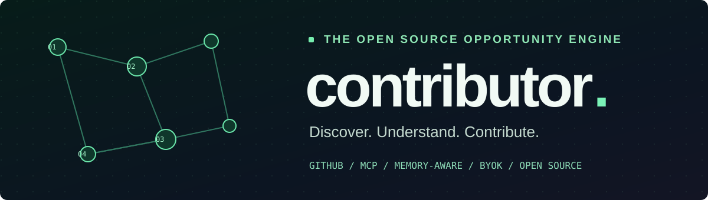
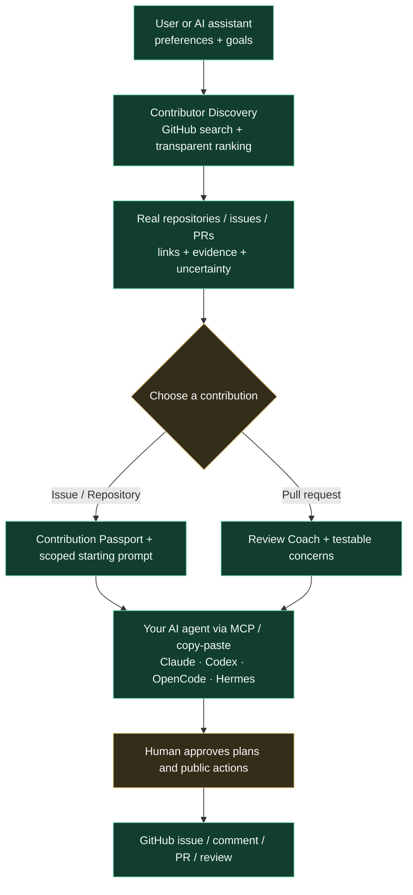

<div align="center">
  
  <h1>Contributor</h1>
  <p><strong>Find your place in open source.</strong></p>
  <p>Discover meaningful GitHub issues, repositories, and pull requests worth reviewing — with transparent matching and optional AI-agent assistance.</p>
  <p>
    
    
    
    
    
  </p>
  <p>
    <a href="https://contributor-7cw.pages.dev">Try it live</a> ·
    <a href="#-try-contributor">Quick start</a> ·
    <a href="#-how-it-works">How it works</a> ·
    <a href="#-mcp-and-your-ai-agent">MCP setup</a> ·
    <a href="#-zero-subscription-economics">Cost</a> ·
    <a href="docs/START_HERE.md">All docs</a>
  </p>
</div>

---

> [!IMPORTANT]
> **Current state (alpha):** The discovery web app is **live at [contributor-7cw.pages.dev](https://contributor-7cw.pages.dev)** with tested ranking, GitHub request logic, repository passports and an optional read-only GitHub sign-in (a Cloudflare Worker). A ten-tool local **MCP server** passes an automated stdio smoke test (`npm run test:mcp`), but it has **not yet been tested against live Claude, Codex, OpenCode or Hermes clients**. CodeRabbit automation and persistent accounts are *planned*, and the browser extension is a scaffold only. No demo result cards are fabricated.

## ✦ The idea

Finding a good repository is harder than writing your first line of code. A search for `good first issue` still leaves you evaluating unfamiliar codebases, abandoned issues, contributor policies, and whether your skills fit.

**Contributor lifts that burden.** Tell it what you know, want to learn, or enjoy doing. It searches GitHub for actual opportunities and provides evidence-backed matches. You decide what to pursue. Your assistant can then help you understand the repository, draft a plan or conduct a careful review.

| Feature | Why it matters | Current status |
|:---|:---|:---|
| **Opportunity Discovery** | Find repositories, issues and review opportunities without a starting URL | **Shipped** (live web app + MCP) |
| **Explainable Matching** | Relevance reasons and transparent heuristic scoring | **Shipped** |
| **AI Handoff Prompts** | Contextual prompt for your chosen GitHub opportunity | **Shipped** |
| **Contributor MCP** | Ask Claude, Codex, OpenCode or Hermes to discover for you | **Shipped; stdio smoke test passes. Live client testing pending** |
| **Repository Passport** | Maintainer responsiveness, guidelines, license and task readiness | **Shipped** |
| **AI Review Coach** | Evidence-based diff/PR assistance, drafts only | **Shipped** (checklists and drafts; you decide what to post) |
| **Hermes Memory Handoff** | Assistant supplies approved relevant preferences, without copying memory files | **Shipped** (consent-gated tool; testing with a live Hermes pending) |
| **BYOK docs** | Clear guidance on bring-your-own-key usage, billing and spend limits | **Shipped** ([BYOK guide](docs/integrations/BYOK.md)) |
| **GitHub sign-in** | Optional read-only login for higher GitHub rate limits | **Shipped** (Cloudflare Worker); no hosted accounts or database yet |
| **CodeRabbit Adapter** | Optional local review evidence for checked-out PRs | **Planned** |
| **Browser Extension** | Get recommendations directly in GitHub pages | **Scaffold only** (badge on issue pages; match overlay *planned*) |

## ◈ Try Contributor

**In your browser (no install):** open **[contributor-7cw.pages.dev](https://contributor-7cw.pages.dev)**. Choose your interests, language, experience, time budget, and whether you prefer issues, repositories or code reviews. Results are fetched live from GitHub’s public API. Anonymous GitHub search is rate-limited; signing in with GitHub (read-only) routes requests through the Contributor Worker for higher limits. To connect an AI assistant, see the **[setup page](https://contributor-7cw.pages.dev/setup.html)**.

**Run it locally:** Node.js 22+ is required. No API key, database, or subscription is needed for the web app.

```bash
git clone https://github.com/EvanGUTK/contributor.git
cd contributor
npm run build
npm run preview
```

Open **http://127.0.0.1:4173/**.

`npm run test` executes the dependency-free unit tests; `npm run check` runs tests plus the build. `npm install` is **not required** to build or preview the static web app; it **is required** before running the MCP server.

## ⌁ How it works



**Discovery comes first.** The MCP entry point is `discover_opportunities`. Users do not need to select an issue or repository first. The tool also supports the user's existing assistant context: if Hermes knows they like computer vision or are learning C++, it can send just those **user-approved** preferences as arguments—not their complete personal memory.

### What a user can ask

> “Find five active open-source Python projects with good issues for an intermediate engineer who enjoys computer vision. I have about four hours this weekend.”

> “Show me unreviewed PRs in developer tools where a careful external review could help, and tell me what I should examine before commenting.”

> “Hermes, use what you know about my interests—with my permission—to find GitHub projects I'd actually enjoy. Don't post anything without asking.”

## ⌘ MCP and your AI agent

This repository includes a **local stdio MCP server** exposing ten read-focused tools:

`discover_opportunities` · `find_review_requests` · `inspect_repository` · `analyze_issue` · `analyze_pull_request` · `prepare_contribution` · `get_contribution_status` · `get_repository_passport` · `request_memory_handoff` · `prepare_review_checklist`

```bash
npm install
npm run mcp
```

The command waits for MCP JSON-RPC messages on **stdio**; it is not an interactive terminal application. Copy-paste registration instructions for each assistant are on the **[setup page](https://contributor-7cw.pages.dev/setup.html)**; the same material and Hermes memory handoff details are in **[MCP client setup](docs/integrations/MCP_CLIENTS.md)**. The v2 server package is used instead of the retired v1 all-in-one SDK.

`npm run test:mcp` runs an automated stdio smoke test (handshake, `tools/list` returning all ten tools, one `discover_opportunities` call). It proves the server speaks the protocol; it does **not** certify any specific client. Live client results are tracked in the [compatibility matrix](docs/integrations/COMPATIBILITY_MATRIX.md).

> [!NOTE]
> MCP uses the **AI model already connected to your assistant**. Contributor doesn't need your Claude/Codex/Hermes model API key. An optional GitHub token can raise public search limits for the local MCP server, but leave it unset if you want entirely anonymous discovery.

## ◇ Zero-subscription economics

| Item | What users pay | What the project pays at MVP |
|:--|:--|:--|
| Static web discovery | **$0** | **$0 goal** on free static hosting |
| GitHub public search | **$0** (rate-limited) | **$0** |
| Local MCP | **$0** Contributor fee | **$0** |
| AI assistant | **BYOK**, optional; existing provider may charge | **$0** model inference |
| CodeRabbit | Optional, dependent on user's own eligibility / plan | **$0** when not integrated |
| Domain | Free hosted subdomain | **$0** |

**Our cost policy:** no Contributor subscription; never proxy or mark up users' AI tokens. We target **$0 for hosting** during the first release and **no more than $10/month in voluntary AI spend** for cost-conscious users. The $10 is a *user budget goal*, not a guaranteed vendor billing cap—external providers control actual charges. We will show provider estimates, warn about expensive work, and require user confirmation where feasible. See [Costs & BYOK](docs/product/COSTS_AND_BYOK.md).

## ⟡ Technical foundation

| Layer | Current design |
|:---|:---|
| Web app | Static HTML/CSS/ES modules, zero dependency build; deployed on Cloudflare Pages |
| Core ranking | Deterministic JavaScript with scored factors and explanations |
| Discovery data | Read-only GitHub REST search; bounded requests; short-lived cache |
| MCP | Node.js + `@modelcontextprotocol/server` v2 + Zod |
| Authentication | Anonymous by default; optional read-only GitHub App login via a Cloudflare Worker (`worker/`) with a signed, HttpOnly session cookie |
| Production UI | React + TypeScript *planned* after validation |
| Optional companion | Local Git worktrees, CodeRabbit CLI, targeted tests (later) |
| Hosting | GitHub Pages / Cloudflare Pages static assets; Workers only if needed |
| Storage | Saved opportunities and preferences stay in your browser’s `localStorage`; no hosted account DB yet (D1 *planned*) |

## ⟡ Repository tree

```text
contributor/
├── README.md                  # Vision, status, quick start
├── LICENSE                    # MIT open-source license
├── web/                       # Live static discovery interface
│   ├── index.html             # Accessible filter UI
│   ├── setup.html             # MCP setup instructions per assistant
│   ├── app.mjs                # Live search, saving and prompt handoff
│   ├── styles.css             # Responsive design system
│   └── assets/                # Favicon
├── worker/                    # Cloudflare Worker: read-only GitHub login + API proxy
│   ├── auth.js                # OAuth code flow, signed session cookie, /api/github proxy
│   └── wrangler.toml          # Worker config (secrets set out-of-band)
├── extension/                 # Manifest V3 browser extension (scaffold only)
├── packages/
│   ├── core/                  # Matching, passport, review coach, memory consent
│   └── github/client.mjs      # Read-only bounded GitHub API adapter
├── apps/mcp/server.mjs        # Ten tools, stdio MCP v2 server
├── tests/                     # Local deterministic unit tests
├── scripts/                   # Static build, preview, MCP smoke test, deploy verification, guarded publishing
├── assets/                    # GitHub README branding
├── examples/                  # Sample discovery briefs and preferences
├── docs/
│   ├── product/               # PRD, cost guardrails, roadmap
│   ├── architecture/          # Architecture, auth flow, data contracts, matching
│   ├── integrations/          # MCP clients, BYOK, Hermes memory, CodeRabbit
│   ├── engineering/           # Security, testing, deployment, validation reports
│   ├── decisions/             # Architecture decision records
│   └── research/              # Primary-source research register
└── .github/ISSUE_TEMPLATE/     # Structured community issue templates
```

## ↗ Start contributing

The project welcomes **issues, focused changes, tests, accessibility fixes, provider-compatibility evidence and documentation**. Read [CONTRIBUTING.md](CONTRIBUTING.md) and [ROADMAP.md](docs/product/ROADMAP.md) before taking on a larger issue. Please do **not** submit auto-generated PR comments or reviews without understanding and verifying them.

**Project status:** alpha. The web app and the read-only GitHub login Worker are deployed; the local MCP server passes its automated stdio smoke test. Not yet done: testing with live Claude, Codex, OpenCode and Hermes clients, human verification of browser CORS/quota behavior, hosted MCP, local CodeRabbit execution, persistent storage and a public-beta security review. See the [roadmap](docs/product/ROADMAP.md).

<div align="center">
  <strong>Find good work. Do good work. Help open source grow.</strong>
  <p><sub>MIT · Free core · BYOK-first · Built for humans and their AI assistants.</sub></p>
</div>