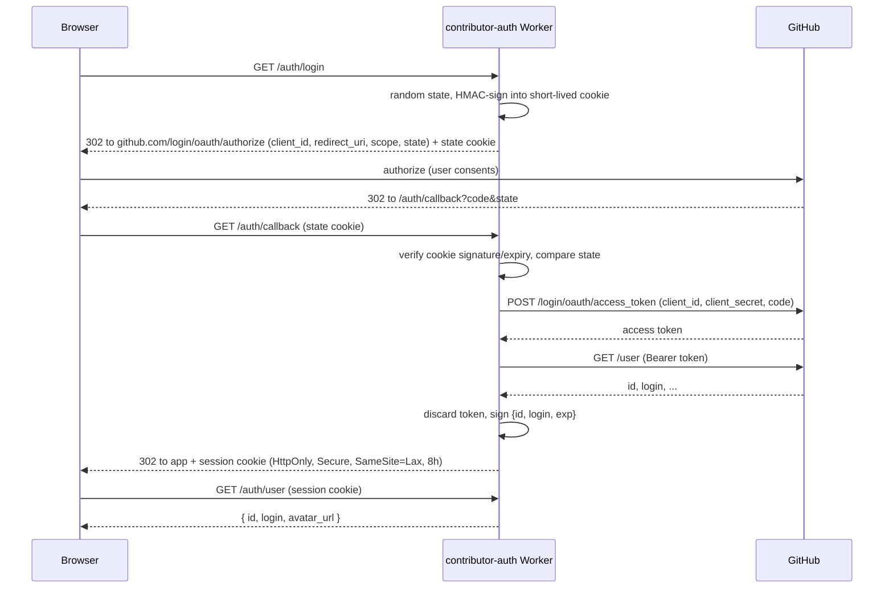

# Authentication architecture (GitHub App read-only login)

Login is optional. Discovery of public repositories and issues works without it. Signing in only lets Contributor know which GitHub account is using it. This is the first auth increment; there is no database, no saved profile, and no write access to GitHub.

## Components

| Piece | Where | Role |
| --- | --- | --- |
| Static site | Cloudflare Pages, `https://contributor-7cw.pages.dev` | UI; calls `/auth/*` |
| `contributor-auth` Worker | Cloudflare Workers, route `contributor-7cw.pages.dev/auth/*` | OAuth code exchange and session cookie (`worker/auth.js`) |
| Contributor App | GitHub App, App ID 5319085 | Read-only: metadata, issues, pull requests |

Secrets (`GITHUB_CLIENT_ID`, `GITHUB_CLIENT_SECRET`, `WORKER_SECRET`) exist only as Worker secrets set with `wrangler secret put`. They are never committed, logged, or sent to the browser. `APP_ORIGIN` is a public setting in `worker/wrangler.toml`.

## Endpoints

| Endpoint | Behavior |
| --- | --- |
| `GET /auth/login` | Creates a random `state`, stores it in a signed short-lived cookie, redirects to GitHub with `client_id`, `redirect_uri`, `scope=read:user`, `state` |
| `GET /auth/callback` | Validates `state` against the signed cookie, exchanges `code` for a token server-side, reads the user identity once, discards the token, sets the session cookie, redirects to the app |
| `GET /auth/logout` | Clears the session cookie, redirects to the app |
| `GET /auth/user` | Verifies the session cookie and returns `{ authenticated, id, login, avatar_url }`, or `401 { authenticated: false }` |

Any failure in login or callback redirects to `/?auth_error=1`. Error details are never sent to the browser. Only `GET` is accepted.

PKCE is not used: the code exchange happens server-side with a client secret, so `state` is the CSRF protection and is mandatory.

## Sequence

## What is stored

- **Session cookie** `contributor_session`: HMAC-SHA256-signed `{ id, login, exp }` where `id` is the numeric GitHub user ID and `login` is the GitHub username. `HttpOnly`, `Secure`, `SameSite=Lax`, `Max-Age` 8 hours.
- **State cookie** `contributor_oauth_state`: signed random `state` and expiry, valid 10 minutes, cleared after the callback.
- `avatar_url` is derived from the numeric ID (`https://avatars.githubusercontent.com/u/<id>`) and is not stored.

## What is NOT stored

- The GitHub access token is never stored, logged, or sent to the browser. It lives in memory for a single request to read the user identity and is then dropped.
- No database, no server-side session table, no email address, no repository data.
- `HttpOnly` means page scripts cannot read the cookie; they learn the identity only through `/auth/user`.

## Revocation and deletion

- **Sign out:** `GET /auth/logout` clears the session cookie immediately. Cookies also expire on their own after 8 hours.
- **Revoke the app:** GitHub, Settings, Applications, Authorized GitHub Apps, Contributor App, Revoke. This invalidates any token GitHub issued for the account.
- Because nothing is kept server-side, there is no Contributor data to delete after logout.

## Privacy

Only data from the user's public GitHub profile (numeric ID, login, avatar) is used. No personal data beyond that is requested or retained. The app asks for read-only access; it cannot comment, open pull requests, or change anything on GitHub.

## Operational notes

- **Rotating `WORKER_SECRET`** invalidates every active session and in-flight login. Users simply sign in again.
- **Testing:** no Worker test runner is configured yet (planned). The Worker was smoke-tested locally against a mocked GitHub; live interoperability with GitHub is unverified until deployed and exercised.
- **Route:** the route uses `zone_name = "pages.dev"`. If Cloudflare does not allow a Worker route on a `pages.dev` host for this account, serve `/auth/*` from a Pages Function or a custom domain instead. This is unverified (planned follow-up).
- **Front-end wiring** (a sign-in button calling `/auth/login` and `/auth/user`) is planned and not part of this increment.
