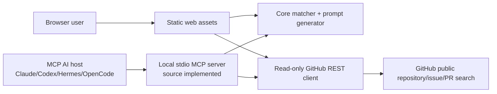
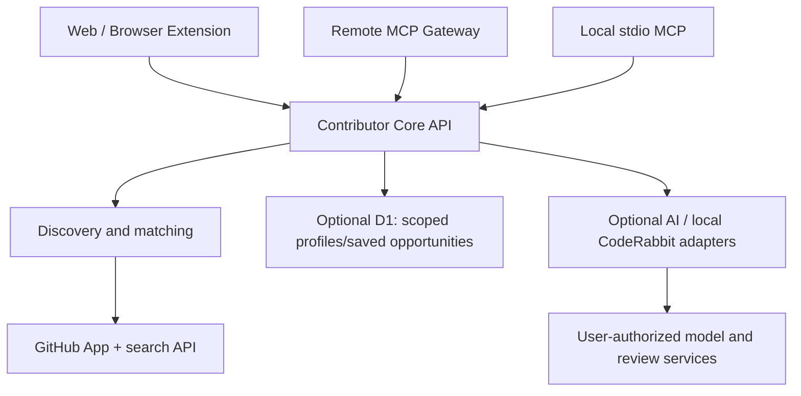

# Contributor system architecture

## Current implemented topology (MVP)

The static web has no service-side tokens or database. GitHub requests are made from the user's browser, with limited caching within the session. No AI inference occurs for matching or ranking. MCP clients run a local process; their own agent handles AI reasoning. The current MCP server has source and syntax checks only, not a live transport assertion in this environment.

## Proposed production boundary (not yet implemented)

A remote MCP server must implement tool-level auth/authorization, scope and rate limits, OAuth/resource server metadata as appropriate, and avoid using the user's model/API key for server-funded inference. It will not share raw Hermes memory or private context.

## Package contracts

- `packages/core/matching.mjs` — preference normalization, scoring, explanation, starter prompts; pure deterministic functions.
- `packages/github/client.mjs` — versioned public REST integration with 12s request timeout, 8-minute in-memory cache, bounded search query and structured errors.
- `web/` — actual discovery form, response cards, outbound GitHub links, clipboard prompts; responsive/no build dependencies.
- `apps/mcp/server.mjs` — MCP v2 tool interface over stdio; Node 22+ and optional GitHub token from local env, no model key.
- `scripts/build-web.mjs` — packages `dist/` for GitHub Pages or Cloudflare Pages, with monorepo import path rewrite.

## Future GitHub authentication

Anonymous read-only discovery works with public data but is rate-limited. For saved profiles and higher limits, GitHub recommends a GitHub App with fine-grained permissions. Avoid embedding client secrets in the browser, and avoid general-purpose user PATs for hosted authentication. OAuth callback must validate state/PKCE, token expiry and user identity; the user can revoke or delete their profile. Future write permission, if added, must be requested separately.

## Failure conditions

| Event | Required behavior |
|:--|:--|
| Rate-limited API | Clear warning, avoid retry storms, offer GitHub-native search link |
| Missing/invalid auth | Fall back to public search if appropriate and user-approved |
| Partial kind failure | Show successful kinds and list which failed |
| Zero matches | Show no-match state, never fabricate suggestions |
| Stale issue | Mark when checked and re-validate before contribution |
| Model host unavailable | Search stays functional; copyable prompt still works |
| MCP server unavailable | Local web remains independent |
| Provider changes MCP behavior | Mark unsupported until tested on release version |

## Data boundaries

No password, API key, personal memory file, private repo content or AI prompt history should be copied into the public browser application. A user's manually typed preferences can be saved in browser localStorage; this is local to that browser, should be optional in a mature privacy UX, and needs a delete control before GA. Alpha currently saves preference inputs locally for convenience—no session-history storage.
